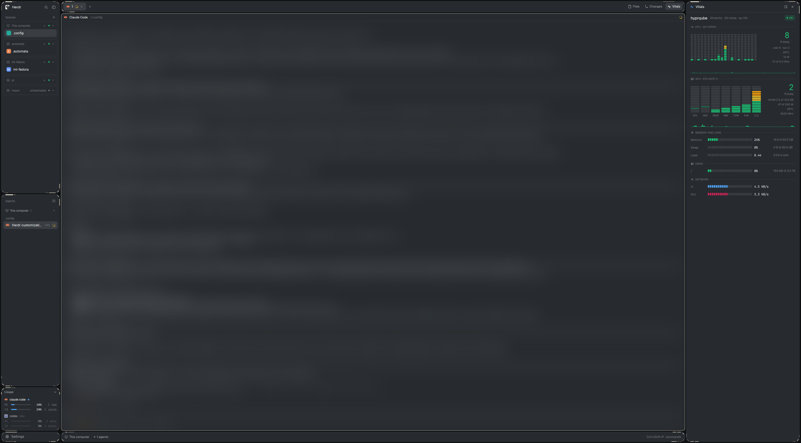

# Glass-Edge for Herdr

A dark, see-through layout for the [Herdr](https://herdr.dev) desktop app: floating islands with cut-corner frames and eggshell accents (every island but the terminals, which Herdr draws itself), a dockable side panel with Files, Changes and Vitals (live CPU and GPU equalizers for every machine), and a sidebar that groups spaces and agents by machine.



## Install

1. Copy `layouts/`, `mods/` and `themes/` into `~/.config/herdr-app/`. Nothing here replaces Herdr's own files.
2. Merge `keys.glass-edge.json` into your `~/.config/herdr-app/keys.json`: `ctrl+alt+v` opens Vitals, `ctrl+alt+p` moves the side panel between the right and the bottom.
3. Check the mods and switch to the layout:

   ```sh
   cd ~/.config/herdr-app
   for m in mods/glass-*/ mods/vitals/; do herdr-app check "$m"; done
   herdr-app do layout.switch --name Glass-Edge
   ```

   `ctrl+shift+l` switches between layouts; `ctrl+alt+shift+escape` always returns to Herdr's default.

### See-through window

Herdr draws an opaque window, so the transparency comes from the compositor. On Hyprland (Omarchy's Lua config):

```lua
o.transparent_window("^(herdr-app)$", "0.8 0.8")
```

## What's inside

| Mod | What it does |
|---|---|
| `glass-chrome` | brand row and Settings footer; the cut-corner frame art (`edge/`) |
| `glass-spaces` | spaces grouped by machine in rounded cards; right-click a machine to rename it or move it, or drag one machine header onto another |
| `glass-agents` | agents list with a View menu: Priority, Grouped by space, Grouped by machine |
| `glass-usage` | Claude Code and Codex plan limits |
| `glass-tabs` | tab bar with Files, Changes and Vitals toggles; moves the side panel between right and bottom |
| `glass-pane` | pane header |
| `glass-status` | status strip: machine, agents, the command palette key |
| `glass-probe` | an invisible full-height block that reports the window height, so the panel can follow the window's shape |
| `glass-files` | file tree, preview, search (names or contents), editing, and transfers between machines (drop to upload, Download, Send to) |
| `glass-changes` | uncommitted changes, wrapped diffs, commit box |
| `vitals` | CPU, GPU, memory, disks and network for the active space's machine |

## Vitals

Vitals runs a small reader program on each machine. On Linux and macOS the panel installs it at `~/.local/share/vitals/vitals` the first time you look at a machine: the machine downloads the build for its OS and CPU from this repo's [releases](../../releases) and checks it against `SHA256SUMS`. It needs `curl` or `wget` there. On the local Windows computer there's no downloaded binary — a bundled PowerShell reader (`mods/vitals/reader.ps1`) is used instead, so no `curl`/`wget`, Go or release build is needed.

- **GPUs:** NVIDIA (`nvidia-smi`), AMD, Intel and Raspberry Pi. A computer's integrated GPU is hidden when it has a discrete one and the integrated one drives no display.
- **CPU power and Intel GPU engine load** read kernel performance counters, which need a one-time grant on each machine. The panel shows the command with a Copy button:

  ```sh
  sudo setcap cap_perfmon+ep ~/.local/share/vitals/vitals && pkill -x vitals
  ```

  A new reader version replaces the file and drops the grant, so run it again after an update.
- **A background sampler** keeps a few minutes of history so the graphs open full. It runs as a systemd user unit where there is one.

To build the reader yourself, run `vitals-src/build.sh` (Go 1.26). While a local build exists in `~/.local/share/vitals/dist`, the panel installs that instead of the release.

## Platforms

- **Linux:** what this is built and tested on (Omarchy, Fedora, Raspberry Pi OS).
- **macOS:** the reader builds for macOS, but this setup hasn't been tried there.
- **Windows:**
  - The layout and every panel work.
  - Files uses PowerShell on the Windows computer itself (search uses ripgrep when it's installed) and `scp` (Windows' built-in OpenSSH) to reach other machines.
  - Vitals reads this Windows computer through a bundled PowerShell reader (`mods/vitals/reader.ps1`): CPU and per-core load, memory, swap, disks, network and NVIDIA GPUs (`nvidia-smi`). CPU temperature/package power and a real load average aren't available on Windows, so those lines are left out (Load is derived from CPU busy). It still reaches your Linux and macOS machines over SSH as before.
  - `ctrl+alt` is AltGr on Windows, so `ctrl+alt+v` and `ctrl+alt+p` may type characters on some keyboard layouts; rebind them in `keys.json` if so.
  - Transparency depends on your compositor, so there's none on Windows.
- **Usage** reads Omarchy's usage cache (`~/.cache/omarchy/agent-usage`) on Linux. On Windows there's no Omarchy, so the panel populates itself while Herdr is open: `mods/glass-usage/populate.ps1` reads your local Claude token from `~/.claude/.credentials.json` and fetches your plan's 5-hour and weekly usage from Anthropic's OAuth usage endpoint — the same numbers `claude`'s `/usage` shows, at no extra token spend — and writes `claude-limits-live.json` into `%LOCALAPPDATA%\herdr\agent-usage`. `mods/glass-usage/usage.ps1` then reads that cache (it also falls back to `~/.herdr/agent-usage` and `~/.cache/omarchy/agent-usage`; you can drop your own `claude-limits-*.json` / `codex-limits-*.json` there instead — see `mods/glass-usage/usage-cache.example.json`). The token is only read and sent to Anthropic — never stored, logged or shared — and if it's expired or you're offline the last cache stays. It refreshes about every 5 minutes while Herdr runs; to refresh while Herdr is closed, schedule `populate.ps1` yourself. Codex works the same way: `populate.ps1` reads the access token from `~/.codex/auth.json`, asks `https://chatgpt.com/backend-api/wham/usage` (the call Codex makes for `/status`) and writes `codex-limits-live.json`; offline or with an expired token it falls back to the `rate_limits` in `~/.codex/sessions` logs (as fresh as your last Codex turn). The island hides itself when there's no data.

## Releasing

Push a tag like `v0.1.0`; the workflow builds the readers, writes `SHA256SUMS` and publishes the release. Keep `VERSION` in `mods/vitals/main.js` in step with the tag.

## Credits

- `mods/vitals` and `vitals-src` started as [herdr-vitals](https://github.com/mrolafsson/herdr-vitals) 0.3.1 by Hjortur Stefan Olafsson (MIT).
- `mods/glass-usage` is adapted from [NA29 Islands](https://github.com/NA29/na29s-islands) sleek-usage (Apache-2.0).
- The Files, Changes, Agents and Spaces additions follow ideas from [Neon Borough](https://github.com/TwoD97/neon-borough) by TwoD97 (MIT).
- The `glass-*` mods are built on Herdr's own mods.
