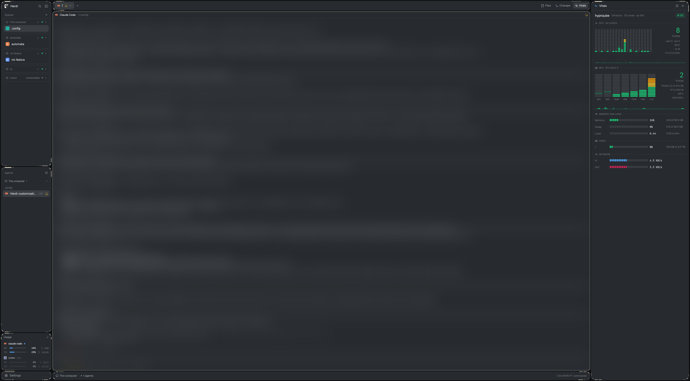

# Glass-Edge

A dark, see-through Herdr layout of floating islands: the sidebar islands have 45° cut corners with eggshell accent lines, the side panel docks right or bottom and holds Files, Changes and Vitals, and spaces and agents group by machine.

## What you see

Left to right, top to bottom (sizes at zoom 1):

- **Canvas** `#101214`, padding 5, gap 5 between islands. Theme `Vibrant-Night` (background `#272b30`, foreground `#ffffff`, accent `#4d9be6`), terminals Liberation Mono 12, terminal padding 14 × 12. Layout `chrome` is `#00000000` so mods draw no square chrome over the islands.
- **Sidebar**, 268 px, a column of islands (gap 5):
  - **Spaces island**: brand row (46 px: logo, "Herdr", search and sidebar buttons) and Spaces. Each machine is a rounded card (`surface`, border, radius 8) with its spaces inside.
  - **Agents island**: agents list; View menu top right.
  - **Usage island**, 164 px: Claude Code and Codex 5-hour and 7-day limits.
  - **Footer island**, 38 px: Settings.
  - Each island (sidebar, tab bar, side panel and status strip; not the terminal panes, which Herdr draws) is drawn by its mods as a cut-corner frame: 10 px 45° cuts with the `border` color along the cut; an eggshell (`#f0ead6`) line parallel inside each cut, full at top-left and bottom-right, 40 % at the other two; a 26 px eggshell bar and two fading 4 px dashes along the top edge from the top-left cut and along the bottom edge from the bottom-right cut; faint 10 px bars by the other two cuts; side rails (2 × 18 px) on the left near the top and the right near the bottom, except on the short ones (footer, tab bar, status strip).
- **Work column**:
  - **Tab bar** island, 42 px: tabs with + right after the last one, Files / Changes / Vitals toggles, window buttons.
  - **Terminals**: panes as cards (radius 10, gap 5, a header on each); the focused pane's border is eggshell `#f0ead6`.
  - **Side panel** island, 368 px on the right or 280 px at the bottom; a stack of Files, Changes and Vitals. On the right in a landscape window it runs the full height beside the tab bar; in a portrait window the tab bar spans the full width above it.
  - **Status** island, 38 px (as tall as Settings): under the terminals when the panel is on the right, at the very bottom when it's at the bottom.

## How it behaves

- **Agent status** shows as in Herdr: working spins, blocked and done get a dot, sub-agents fold under their parent.
- **Dock button** in each panel's header (or `ctrl+alt+p`) moves the panel between right and bottom, each side keeping its own size, and moves the status strip with it.
- **Side panel tabs** each have a dock button and a close button in their header, and are remembered per space; a hidden tab doesn't refresh until shown.
- **Spaces**: click a machine header to fold it; right-click it to rename it, move it up or down or restore its name; drag one machine header onto another to reorder. Names and order are shared with the Agents list.
- **Agents**: View menu (Priority, Grouped by space, Grouped by machine).
- **Files**: lazy tree of the focused pane's folder on its machine, with git marks. Search by name or contents (ripgrep or grep, skipping `node_modules`, `.git`, build folders). Preview a file; Edit files up to 200 KB and Save (or `ctrl+s`), refused when the file changed on disk. Right-click a row: Open, Download (to `~/Downloads`), Send to (another machine's `~/inbox`), Copy path, Show in folder. Drop files from the desktop on a folder to upload. A Transfers drawer lists copies.
- **Changes**: changed files with counts; diff lines wrap onto rows marked ↳; commit box.
- **Vitals** follows the active space's machine:
  - **CPU**: a per-core equalizer and a history strip. Under the big busy % sit user/sys, temperature, power and clock.
  - **GPUs**: one equalizer per GPU (NVIDIA: GPU, VRAM, PWR, TEMP, FAN, CLK; Intel engines or clock; Pi V3D queues), each with a history strip and VRAM, power, temperature and clock under the big %.
  - **Colors**: bars, strips and big numbers go green under 40 %, yellow under 60 %, orange (`#ff9f0a`) under 80 %, then red.
  - **Two columns** when wide: CPU, memory and load, then disks on the left; GPUs and network on the right, in one scroll, with the CPU block stretched to the first GPU block's height.
  - **Units**: RAM, swap and VRAM in binary GB; disks and network in decimal.
  - **Permission notice**: when CPU power or Intel engine load needs it, a box shows the `setcap` command with a Copy button.

## Built from

Layout `layouts/Glass-Edge.json`: root row → `islands` row of `sidebar` (column: `spaces-island` [`brand` glass-chrome {frame: top}, `spaces` glass-spaces {frame: bottom}], `agents` glass-agents {frame: all}, `usage` glass-usage {frame: all}, `sidebar-footer` glass-chrome {footer, frame: "all small"}) and `work` (column: `tabs` glass-tabs {frame: "all small"}, `work-body` row/column of `main-col` [`main` tab block with glass-pane headers, `status` glass-status {frame: "all small"}] and `panel` → `panel-body` stack of `files` glass-files, `changes` glass-changes, `vitals` vitals, each {frame: all}).

- `frame.js` (identical in every framed mod: glass-chrome, glass-spaces, glass-agents, glass-usage, glass-tabs, glass-status, glass-files, glass-changes, vitals) draws an island's face behind the mod: corner tiles from `mods/glass-chrome/edge/{fill,edge,accent}-{tl,tr,bl,br}.svg` (one-color layers tinted with `background`, `border` and eggshell), edges and middle as plain divs, then the trim. The cuts are left empty, so the canvas shows through. Each island picks a trim variant (`v0`…`v6` in its `frame` prop: which corners are bright, runs of bars, fading dashes, split bars and trailing lines along the edges, side rails) so no two look alike.
- `glass-tabs` docks by rewriting the layout with `layout.set`: `work-body` row ↔ column, `status` moved between `main-col` and `work`, and a right panel moved into `islands` (landscape) or `work-body` (portrait). Window height comes from `probe-h`, a zero-width `glass-probe` block beside `islands` that writes shared `glass.window` and runs `glass-tabs.arrange`. Width is the tab bar's measured width plus the sidebar and a full-height panel. A 5 % band keeps a near-square window from flipping.
- Shared state `glass.machines` = `{ names, order }`, keyed by machine name or `local`.
- `vitals` runs `vitals-src` (Go) on each Linux/macOS machine: `app '{"op":"now"}'` returns one JSON reading. The reader is installed from GitHub releases (`vitals-{linux,darwin}-{amd64,arm64}` + `SHA256SUMS`), downloaded on the machine itself; a local `~/.local/share/vitals/dist` build wins. On the local Windows machine there is no Go build: `vitals` runs `mods/vitals/reader.ps1` (PowerShell + `nvidia-smi`), which emits the same `now` JSON (`install` returns a `win:<path>` marker and `ask` runs the script); remote machines are unchanged.
- herdr functions: `spaces`, `agents`, `panes`, `terminals`, `machines`, `focused`, `layout`, `exec` (with `on`), `hc`, `readTextFile`, `writeTextFile`, `watchFolder`, `shared` / `setShared`, `openOverlay`, `run` (`layout.*`, `space.*`, `tab.*`, `pane.*`). Programs: `git`, `sh`, `scp`, `ssh`, `curl` or `wget`, `rg` or `grep`, `find`, `python3` or `powershell` (Usage), `powershell` (Windows Vitals), `nvidia-smi`.

## Watch out

- `run` arguments may nest at most 16 levels: a deeper layout tree throws in `layout.set`, so keep wrappers out of the tree.
- Mods can't import across folders (`resolves outside the application directory`), so `frame.js` is copied into each framed mod.
- Terminal panes keep Herdr's own frame: mods can't draw over or behind a terminal, so pane corners can't be cut.
- `render`'s context can't `notify`; size changes come from `on_size_change`.
- herdr-core ends every process tagged with its `HC_SCOPE` when a command returns: the Vitals sampler's systemd unit must not inherit `HC_*` variables.
- `setcap` grants live on the file: a new reader build drops them.
- On Windows, Files' own-computer actions use PowerShell (`New-Item`, `Copy-Item`, ripgrep or `Get-ChildItem` | `Select-String`) and Explorer; other machines are reached as Unix over `scp` and `exec` with `on`. Usage runs `mods/glass-usage/usage.ps1` instead of `python3` (which can be the Store's installer stub), reading Omarchy-format `claude-limits-*.json` / `codex-limits-*.json` from `%LOCALAPPDATA%\herdr\agent-usage` (then `~/.herdr/agent-usage`, `~/.cache/omarchy/agent-usage`); it hides without a cache. With no Omarchy to fill that cache, the mod self-populates on Windows: on start and every 5 min it runs `mods/glass-usage/populate.ps1`, which reads the Claude OAuth token from `~/.claude/.credentials.json` and GETs `https://api.anthropic.com/api/oauth/usage` (headers: `Authorization: Bearer`, `anthropic-version`, `anthropic-beta: oauth-2025-04-20`), mapping `five_hour`/`seven_day` `utilization` + `resets_at` into the cache. The token is only read, never written; an expired token or offline run leaves the old cache. Codex limits come from GET `https://chatgpt.com/backend-api/wham/usage` (headers: `Authorization: Bearer` from `~/.codex/auth.json` `tokens.access_token`, `ChatGPT-Account-Id`), mapping `rate_limit.primary_window` / `secondary_window` `used_percent` + `reset_at` into the cache; the token is only read. If that fails, it falls back to `rate_limits` in the newest `~/.codex/sessions/**/rollout-*.jsonl` (as fresh as the last Codex turn; a window past its reset reads 0 %). Vitals reads the local Windows machine via `mods/vitals/reader.ps1`; CPU temperature, package power and a real load average aren't available there (Load is derived from CPU busy).
- Shipped mods and layouts are replaced on every Herdr start: edit the `glass-*` copies, never the originals.
- Tested on Herdr 0.1.14.

## Done when

- `herdr-app check` passes for every `glass-*` mod and `vitals`, and `herdr-app status` lists no file errors after `layout.switch Glass-Edge`.
- The sidebar islands show cut corners with eggshell accents and empty (see-through) cuts.
- The dock button moves the panel and the status strip; the right panel runs full height.
- Vitals on a machine with an NVIDIA GPU shows the GPU equalizer, and a fresh machine gets the reader from the release.
- On Windows, Vitals shows this computer (CPU and per-core, memory, swap, disks, network and any NVIDIA GPU), and Usage shows once a `claude-limits-*.json` lands in `%LOCALAPPDATA%\herdr\agent-usage`.
- Files search finds a word inside a file; Download of a remote file lands in `~/Downloads`.
